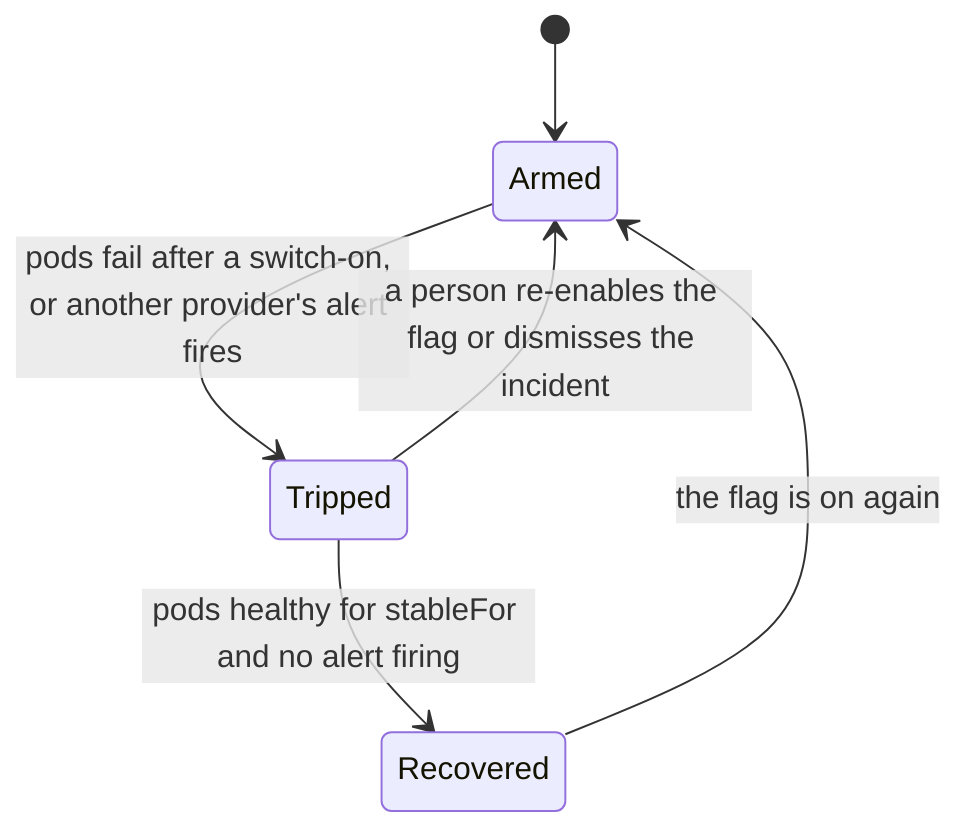

# Flagbreaker

**A circuit breaker for Flagsmith flags on Kubernetes.** When a workload breaks
right after a flag is switched on, Flagbreaker:
- reports it to [Flagsmith Feature Health](https://docs.flagsmith.com/advanced-use/feature-health);
- switches the flag off (in act mode);
- restarts the crashed pods;
- confirms on the cluster that the workload recovered.

[](https://github.com/Pradyuman-aviator/flagbreaker/actions/workflows/ci.yml)
[](LICENSE)


<!-- Demo video: add the link here. -->

A flag flip changes production without a deploy:
- **Rollout tools can't see it.** Argo Rollouts and Flagger watch new
  ReplicaSets, and a flag flip creates none.
- **Nothing in open-source Flagsmith acts on it.** Flagsmith records
  Feature Health, but nothing in its open-source code acts on an Unhealthy
  event.

Flagbreaker is both halves:
- **A provider:** it sends Kubernetes workload health to Feature Health.
- **An actuator:** it turns Unhealthy, from any provider, into a switch-off
  that is checked on the cluster.

## Try it

You need Docker (with about 3 GB of memory free), bash, curl and jq. On
Windows, use Git Bash. The scripts download their own pinned kind, kubectl and
helm into `./bin`, checked against SHA-256 values in the repo, and never touch
your `~/.kube/config`.

```sh
git clone https://github.com/Pradyuman-aviator/flagbreaker && cd flagbreaker
bash hack/demo/up.sh        # kind + self-hosted Flagsmith + Flagbreaker + a demo app; ~8 min the first time
bash hack/demo/break.sh     # switch new_pricing on, the way a person would
bash hack/demo/e2e-all.sh   # or run every scenario end to end (~3 min)
bash hack/demo/down.sh      # delete it all
```

`up.sh` builds the whole demo through Flagsmith's API, with no clicks in the
dashboard:
- self-hosted Flagsmith 2.295.2, from its official Helm chart;
- an organisation, a project and a Production environment;
- the flags, a segment, two Feature Health providers and a signed webhook;
- Flagbreaker, from the Helm chart in this repo;
- `checkout`, a small Go app that reads its flags with the Flagsmith SDK.

At the end it prints the dashboard URL and an admin login. If ports 8000 and
8080 are taken, run `API_PORT=18000 UI_PORT=18080 bash hack/demo/up.sh`.

What happens after `break.sh` comes from a real run on this demo. The times
are UTC, from `kubectl get flagguard -n shop checkout-new-pricing -o yaml`:

```
13:05:17  new_pricing was switched on in Production by admin@flagbreaker.local
13:05:19  Deployment shop/checkout: 1 of 2 pods started failing 2s after the flag was switched on by admin@flagbreaker.local at 13:05:17 UTC
13:05:19  Switched new_pricing off in Production (its environment default and 1 segment override). Identity overrides and experiments are not changed.
13:05:19  Restarted 1 crashed pod, so the workload reads the flag again now instead of after the kubelet's back-off
13:05:42  Verified recovery: all 2 pods ready with no new crashes for 22s. Detected 2s after the change, switched off 0s after that, recovered 24s after the switch-off.
```

The same timeline appears in Flagsmith, on the flag's **Health** tab. The flag
also carries the **Unhealthy** tag for the length of the incident.

## How Flagsmith is used

Flagsmith is where every decision starts and ends. Take Flagsmith away and
Flagbreaker has nothing to watch, nothing to switch and nowhere to report.

| Flagsmith feature | What Flagbreaker does with it |
|---|---|
| Flags, through `/api/__future__/environments/{key}/features/{id}/` | Reads the flag. Switches off the environment default and every segment override that is on, in one versioned change. A restore turns them back on. |
| Feature Health, Webhook provider | Reports Unhealthy and Healthy with the incident timeline, the failing pods and runbook links, which show in the flag's Health tab and as the Unhealthy tag. |
| Feature Health events (the Grafana / Prometheus Alertmanager provider, or any other) | Trips on another provider's alert for the flag. Waits for the alert to clear before calling the workload recovered. Treats a person's **Dismiss** as an acknowledgement. |
| Environment webhooks (`FLAG_UPDATED`, HMAC-SHA256 signed) | Learns exactly when a flag changed and who changed it. |
| Remote config, read with the official Go SDK | Reads the breaker's own settings: `flagbreaker_enabled` (the brake), `flagbreaker_mode` (watch or act) and `flagbreaker_policy` (a mode per flag, as JSON). |
| Change requests | Flagbreaker never gets around them. A 409 drops it to watch mode with a `BlockedByChangeRequests` condition. |
| Self-hosting | The demo runs Flagsmith from its official Helm chart and sets it up through the API. It also turns on the dashboard's own Feature Health screens, which stock self-hosted installs hide, by pointing the dashboard at a local Flagsmith-on-Flagsmith project. |

## Guard a workload

The one-line way is a pair of annotations. Flagbreaker creates a FlagGuard per
flag, owned by the workload:

```sh
kubectl annotate deployment checkout -n shop \
  flagbreaker.dev/flags=new_pricing,express_checkout \
  flagbreaker.dev/environment-key=<client-side environment key>
```

This works on Deployments, StatefulSets and DaemonSets. For every setting,
write the FlagGuard yourself:

```yaml
apiVersion: flagbreaker.dev/v1alpha1
kind: FlagGuard
metadata:
  name: checkout-new-pricing
  namespace: shop
spec:
  flag: new_pricing
  environmentKey: "<client-side environment key>"
  workload: {kind: Deployment, name: checkout}
  window: 10m        # how long after a switch-on a breakage is blamed on it
  failingPods: 1     # how many pods must fail
  stableFor: 30s     # how long the pods must stay healthy to count as recovered
  links:
    - {title: Runbook, url: "https://example.com/runbook"}
```

A namespace may act only on environments a cluster admin has allowed for it.
Flagbreaker uses an organisation API key, so this keeps one team from
switching off another team's flags:

```sh
kubectl annotate namespace shop flagbreaker.dev/allowed-environments=<key>
```

**Watch or act.** Flagbreaker asks three places:
- the guard's `spec.mode`;
- `flagbreaker_policy` for that flag;
- `flagbreaker_mode`.

The most cautious answer wins. It switches a flag off only when something says
`act` and nothing says `watch`. Out of the box, and whenever Flagsmith can't
be read, it watches: it reports and changes nothing. `flagbreaker_enabled`
off pauses it everywhere.

**Turning the flag back on is up to a person.** Fix the cause, then either:
- switch the flag on in Flagsmith;
- or restore it exactly as it was, including the segment overrides
  Flagbreaker switched off:

  ```sh
  kubectl annotate flagguard -n shop checkout-new-pricing flagbreaker.dev/restore=$(date +%s) --overwrite
  ```

Either way the flag is watched again, and a second breakage trips the breaker
again. The [runbook](docs/runbook.md) covers each step.

## Install in your cluster

```sh
kubectl apply --server-side -f charts/flagbreaker/crds/
helm install flagbreaker oci://ghcr.io/pradyuman-aviator/charts/flagbreaker --version 0.1.0 \
  -n flagbreaker-system --create-namespace \
  --set flagsmith.url=http://flagsmith-api.flagsmith:8000 \
  --set flagsmith.apiKey=<organisation API key> \
  --set flagsmith.healthWebhookPath=/api/v1/feature-health/<path> \
  --set flagsmith.settingsEnvironmentKey=<environment holding the flagbreaker_* flags>
```

- **`healthWebhookPath`.** Create a Webhook provider under Project Settings
  → Feature Health, or call `POST /api/v1/projects/{id}/feature-health/providers/`
  with `{"name": "Webhook"}`. Keep only the path of the `webhook_url` it
  returns; the path is the credential.
- **Webhooks (optional, for exact change times and authors).**
  - Point an environment webhook at `http://flagbreaker-webhook.flagbreaker-system.svc:8082/webhooks/flagsmith`.
  - Give it a secret, and pass the same secret as `flagsmith.webhookSecret`.
  - Add that host to Flagsmith's `SSRF_ALLOWED_HOSTS`.
- **Building from source.** Run `docker build -t flagbreaker .`, then
  `helm install … ./charts/flagbreaker --set image.repository=flagbreaker --set image.tag=latest`.
- **More settings.** See [values.yaml](charts/flagbreaker/values.yaml).

## What's real and what's staged

- **Real:**
  - Flagsmith 2.295.2, with its API, webhooks, Feature Health and dashboard;
  - the Kubernetes cluster and the pods crashing;
  - the switch-off, the pod restarts and the recovery check.
- **Staged:**
  - The demo app's bug: `checkout` exits while `new_pricing` is on.
  - The Grafana alert, which `hack/demo/alert.sh` posts to Flagsmith's
    Grafana provider in the format Alertmanager uses. There's no Prometheus
    in the demo.

## Why not Argo Rollouts, Flagger, or an Alertmanager rule?

- **Argo Rollouts and Flagger** roll back deploys. A flag flip is not a deploy,
  so they never see it.
  - If a rollout starts within 30 s of a flag change, Flagbreaker doesn't
    blame the flag; it only reports.
- **An Alertmanager rule** can already mark a flag Unhealthy through
  Flagsmith's Grafana provider, but nothing in open-source Flagsmith then
  switches the flag off. Flagbreaker acts on those alerts too.
- **Flagsmith's Release Pipelines** can abort on an unhealthy flag, but they
  are a closed beta. Flagbreaker is open source and guards any flag at any
  time, and it checks recovery on the workload itself, because an API call
  that succeeds proves nothing about the pods.

## Under the hood



- **The decisions** live in one pure function,
  [`breaker.Decide`](internal/breaker/decide.go).
- **The controller** is built on controller-runtime, with leader election,
  Kubernetes Events and Prometheus metrics, such as
  `flagbreaker_detection_seconds` and `flagbreaker_recovery_seconds`.
- **The design notes,** in [docs/design.md](docs/design.md), cover the full
  rules, every Flagsmith endpoint, the safety measures and the metrics.
- **Tests.** 73 Go tests cover the rules, the client, webhook verification,
  and whole incidents run through `Reconcile` against a fake Flagsmith. CI
  runs them on every push, then brings up the demo on a fresh kind cluster
  and runs every end-to-end scenario.
- **Where it has run.**
  - It has run end to end on Windows 11 (Git Bash, Docker Desktop) and on
    Ubuntu in CI.
  - On macOS, the scripts are checked under its bash 3.2 and every image is
    multi-arch, but it hasn't been run end to end there yet.

## Limitations

- **Only the environment default is tracked as a flag change.** A rollout
  through a segment override alone is caught only by an alert.
- **Identity overrides and experiments are never switched off.** The timeline
  says so.
- **Who made a change can be missing.** Flagsmith sends `FLAG_UPDATED` with
  the state at send time, a few seconds after the change. If Flagbreaker
  switches the flag off within those seconds, the timeline may give the
  person's change without a name.
- **Feature Health is a beta, and `/api/__future__` is marked experimental.**
  The demo pins Flagsmith 2.295.2.
- **Unlicensed self-hosted Flagsmith allows one project and one seat per
  organisation.** So the demo uses an organisation API key, not a
  least-privilege user.

## License

[Apache-2.0](LICENSE)
