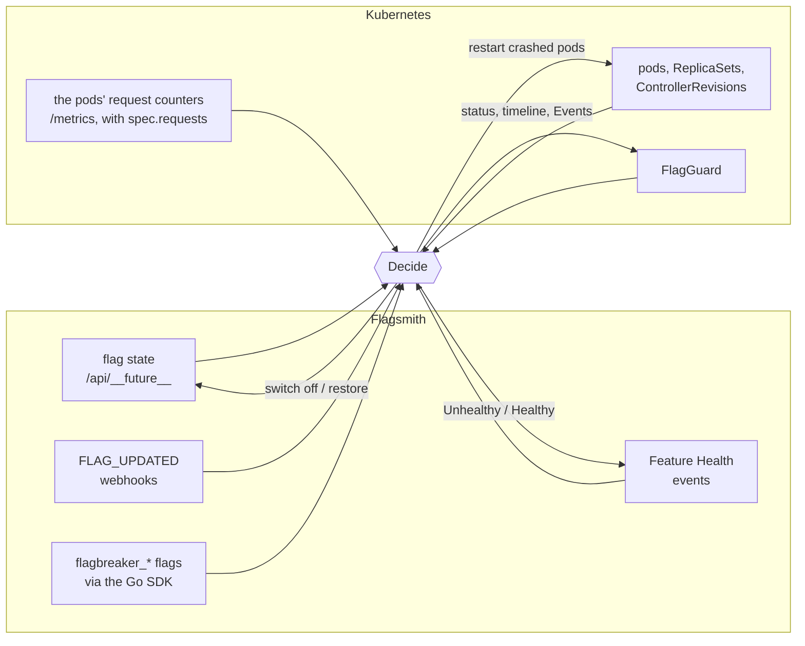
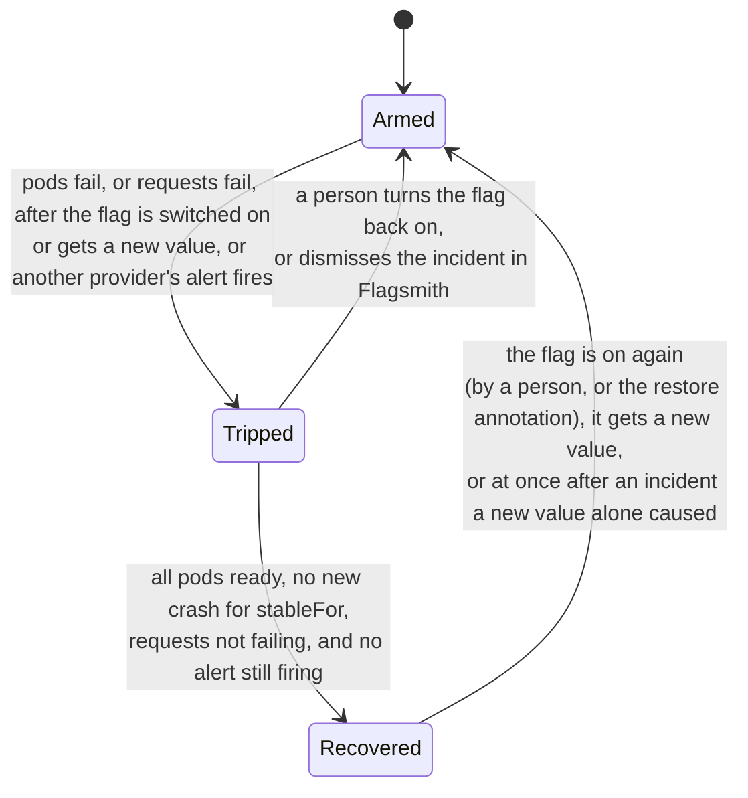

# How Flagbreaker works

Flagbreaker is a Kubernetes controller that connects Kubernetes workload
health to [Flagsmith Feature Health](https://docs.flagsmith.com/advanced-use/feature-health).
When a workload breaks right after a flag is switched on or given a new
value (its pods fail or, for a guard that reads requests, its requests start
failing with 5xx), or another Feature Health provider marks the flag
unhealthy, Flagbreaker:

1. reports Unhealthy to Feature Health, with an incident timeline;
2. in act mode, switches the flag off in that environment, for its default
   and every segment override that is on. If a new value caused it, it puts
   the previous value back instead;
3. restarts the pods that crashed;
4. confirms recovery on the cluster and reports Healthy.

Flagbreaker never switches a flag back on by itself.

Open-source Flagsmith stores Feature Health events, but nothing in it acts on
them. Flagbreaker is a provider, sending Unhealthy events from Kubernetes, and
an actuator, acting on any provider's events.

## The loop

Every check, run per FlagGuard, does the following:
- It reads the flag, the workload's pods and Feature Health, and for a guard
  with `spec.requests`, the request counter of each pod, at most every 4 s.
- It asks one pure function, [`breaker.Decide`](../internal/breaker/decide.go), what to do, then does it.

A check runs:
- when a pod changes;
- when a signed `FLAG_UPDATED` webhook arrives for the flag;
- when the guard or its annotations change;
- every `--sync-period` (5 s by default).

The guard's status holds all incident state, so the controller can restart at
any time. The one exception is the history of request counts, which lives in
memory: after a restart it starts over.

## States

**Trips (Armed → Tripped).** One of these holds:

- **Pods**: the flag was switched on, or its environment default got a new
  value, within `window` (10 minutes by default), and at least `failingPods`
  pods failed after that. A new value counts even while the flag is off,
  because apps read remote config either way. A container that exited
  non-zero or was OOM-killed counts as failing, and so does a pod that was
  ready and then stayed not ready for 20 s. A pod that is not ready within a
  minute of being created, with no restarts, is still starting up and doesn't
  count; evicted pods don't either. A workload that is still crash-looping
  from before the change, however long its back-off, is never blamed on it.
- **Requests**, for a guard with `spec.requests`, when the pods rule didn't
  trip: the same change, with the same window and checks, and both of these
  hold. After the change (in the last minute, or since the change if that is
  later), at least `minRequests` requests arrived and more than
  `maxErrorPercent` of them failed. In the minute ending 5 s before the
  change, at least `minRequests` requests arrived and no more than
  `maxErrorPercent` failed. Every series of the metric counts toward the
  total, and a series whose status label starts with 5 counts as failed;
  4xx is handled, not failed. Every pod may be up and ready.
- **Alert**: the flag's environment default is on, and another Feature
  Health provider has an Unhealthy event for this
  flag that started after the flag was switched on. It counts whether the
  event names this environment or no environment.

**Never blamed**

- A change made while the workload was already failing, in the minute
  before. Kubernetes keeps a container's last crash for a long time, so
  older crashes don't count.
- Failing requests after a change, when requests were already failing in
  the minute before it, or when fewer than `minRequests` arrived then: with
  nothing to compare with, the change isn't blamed. That minute ends 5 s
  before the change, which absorbs clock skew and the read that straddles
  the change. It never starts before the last verified recovery began, so
  an incident's failed requests count for that incident, as its crashes do,
  and not against the next change, such as a restore.
- A change near a rollout: if the workload rolled out any time from 30 s
  before the change onward, the deploy may be the cause, so the trip only
  reports and leaves the flag on.
- A change a person acknowledged, by dismissing the incident in Flagsmith.
- A change that already caused an incident. Each change is blamed once, so
  a workload that heals with the flag still on doesn't trip again.
- A change made while Flagbreaker wasn't running. Its time is unknown until
  a `FLAG_UPDATED` webhook says when it happened.
- An alert event already handled. A person who re-enables a flag despite an
  old alert is respected.
- Flagbreaker's own changes. A crash after it put a value back belongs to
  the incident; blaming the fix would put the bad value back.

**Recovery is verified.** For `stableFor` after the switch-off, every pod must
be ready with no new crash, and no other provider's alert may still be firing.
A successful API call proves nothing about the workload, so Flagbreaker checks
the workload itself. For a guard with `spec.requests`, at least `minRequests`
requests failing over the limit in the last minute count like a crash: the
wait for `stableFor` starts again. Not when more than the limit already
failed in the minute before the change or the alert that caused the
incident: that is the workload's normal, and the incident could never end.
The trip notes it in `status.requestsFailingBefore`. After an incident that
failing requests caused, at least `minRequests` requests must also have
arrived since, with no more than the limit failing; without traffic the
guard stays tripped, until readings come back or a person dismisses the
incident. An incident the pods or an alert caused doesn't wait for traffic,
and when the metrics can't be read, it recovers on the pods as before. With
`restartCrashingPods`, the pods that crashed are deleted once the flag is
off. They then come back in seconds, not after the kubelet's back-off, which
can reach five minutes.

**A bad value is put back, not switched off.** Remote config is read
whether or not the flag is on: the Flagsmith Go SDK's `GetFeatureValue`
returns the value without looking at `enabled`. So when a new value caused
the incident, act mode sets the environment default's value back to what it
was, in one versioned change, and leaves the flag on or off as it was. It
does that only while the flag still has the value that caused it; a person's
later change stands. In watch mode, a person setting any other value counts
as the fix, as a switch-off does for a switch-on; switching the flag off
doesn't. After verified recovery there is nothing left to wait for, so the
guard is armed again at once; a Healthy report still on its way says the
recovery was verified.

**Both at once: recover first, blame second.** People often switch a flag
on and edit its value close together, or in one save. When the workload
breaks within `window` of both, nothing says which one did it, so each
counts as a cause: act mode switches the flag off and puts the previous
value back, and a watch-mode incident ends when a person switches the flag
off. A fix, Flagbreaker's or a person's, belongs to its incident and is never
blamed for a breakage itself, since blaming it would undo it.

**Restore.** The `flagbreaker.dev/restore` annotation undoes Flagbreaker's
own switch-off. It turns on the environment default and only the segment
overrides that still exist and are still off.

- It goes through Flagsmith's update API, which creates an override that
  doesn't exist. Restoring only existing overrides keeps a person's later
  deletion deleted.
- It is refused while the guard is still tripped.
- The restore counts as a flag change. If the workload breaks again, the
  breaker trips again, which makes it a half-open probe on demand.

## Who decides the mode

Flagbreaker asks three settings, and the most cautious answer wins. It
switches a flag off only when something says `act` and nothing says `watch`.
With no answer at all, it watches.

| Setting | Where | Scope |
|---|---|---|
| `spec.mode`, or the `flagbreaker.dev/mode` annotation | Kubernetes | one guard |
| `flagbreaker_policy`, for example `{"new_pricing": {"mode": "watch"}, "new_payments": {"mode": "act", "maxErrorPercent": 2}}` | Flagsmith remote config | one flag (`off` ignores it) |
| `flagbreaker_mode` (`watch` or `act`) | Flagsmith remote config | every flag |
| `flagbreaker_enabled` | Flagsmith flag | off pauses everything |

These settings can also change the mode during an incident:

- A switch to `watch` in Flagsmith stops an incident that is acting.
- A switch to `act` never takes effect mid-incident.
- If Flagsmith can't be read, or the policy is invalid JSON, Flagbreaker
  watches.

A policy entry's `maxErrorPercent`, a number above 0 and up to 100 (decimals
allowed), replaces `spec.requests.maxErrorPercent` for that flag's guards,
and the trip says it came from `flagbreaker_policy`. It never turns request
reading on by itself. Any other value makes the whole policy invalid, so
every flag is watched and `SettingsValid` is False until it is fixed.

## Flagsmith APIs used

All of these are in open-source, self-hosted Flagsmith. Flagbreaker is tested
against 2.295.2.

| Endpoint | For | Auth |
|---|---|---|
| `GET /api/v1/environments/{key}/` | environment name, ID and project | org API key |
| `GET /api/v1/projects/{id}/features/?search=` | feature ID, matched by exact name | org API key |
| `GET`/`PATCH /api/__future__/environments/{key}/features/{id}/` | read the flag and its value; switch off the default and segment overrides in one versioned change; put a previous value back; restore | org API key |
| `GET /api/v1/projects/{id}/feature-health/events/` | other providers' alerts, and dismissals of Flagbreaker's own events | org API key |
| `POST /api/v1/feature-health/{signed-path}` (Webhook provider) | report Unhealthy and Healthy, with text and URL blocks | the signed path |
| environment webhook `FLAG_UPDATED` (HMAC-SHA256 `X-Flagsmith-Signature`) | exact time and author of a switch or a value change | shared secret |
| Flagsmith Go SDK, `GetEnvironmentFlags` | the breaker's own settings, including `maxErrorPercent` in `flagbreaker_policy` | environment key |

The `__future__` endpoint works with and without feature versioning. The older
feature-state endpoints return 400 under versioning v2. Request checking uses
no new endpoint: the counts come from the pods, and the trip, the fix and the
report go through the endpoints above.

## Safety

- **Namespace fence.** Flagbreaker acts with an organisation API key.
  - A FlagGuard may act only on Flagsmith environments that its namespace
    lists in the `flagbreaker.dev/allowed-environments` annotation, as
    client-side keys or `*`.
  - Namespaces are cluster-scoped, so only a cluster admin can grant this.
    A user who can create FlagGuards in one namespace can't switch off
    another team's flags.
  - A guard that isn't allowed reads and writes nothing in Flagsmith.
  - `--require-namespace-opt-in=false` turns the check off.
- **Leader election.** Only one replica ever changes flags.
- **Change requests.** If an environment requires change requests, Flagsmith
  answers 409. Flagbreaker then drops to watch and sets the
  `BlockedByChangeRequests` condition; it never gets around four-eyes approval.
- **What it never touches.** It doesn't change identity overrides or
  experiments' system segments. The timeline says so instead of claiming a
  clean switch-off.
- **What it reads.** For a guard with `spec.requests`, Flagbreaker sends
  `GET http://<pod IP>:<port><path>` only to the guarded workload's own
  running pods, at most 20, by name; the spec holds no URLs. Pods on the
  host network are skipped, since their ports are the node's. It goes
  through no proxy and follows no redirects. It reads at most once every
  4 s per guard, gives each pod 2 s and a whole read 3 s, and refuses
  answers over 8 MiB. Only the named metric's lines are parsed, and an
  error is capped at 200 characters, so an answer is never echoed into the
  status. A guard without `spec.requests` reads nothing, and a guard that
  fails the namespace fence reads no pods either.
- **One health slot.** Feature Health keeps one Webhook-provider status per
  flag and environment. Healthy is reported only when every guard of that flag
  has recovered.
- **Fresh reads, kept writes.** Each check reads the guard past the
  controller's cache. If writing the status fails after the flag was already
  switched off, the status is kept and written on the next check, so an
  incident is never forgotten.
- **No silent no-ops.** Redirects are followed only for GET. After every
  switch-off, the environment default Flagsmith returns is checked to be off.
  A switch-off that timed out is marked, so if Flagsmith applied it after all,
  it is recorded as Flagbreaker's, not a person's.
- **Deleting a guard mid-incident.** A finalizer clears its Unhealthy event
  and says that this isn't a verified recovery.
- **Credentials.** The org API key and the Feature Health path live in a
  Secret, never in flags or the pod spec. The secret path is redacted from
  every error, including network errors, so it never reaches a FlagGuard's
  status or the logs.

## Watching a workload

You can watch a workload in two ways:
- The one-line way: annotate a Deployment, StatefulSet or DaemonSet with
  `flagbreaker.dev/flags: "flag_a,flag_b"`. Flagbreaker creates one FlagGuard
  per flag, owned by the workload, and deletes them with it.
- The full way: write a FlagGuard yourself.

The annotation can also set these options:

| Annotation | Sets |
|---|---|
| `flagbreaker.dev/environment-key` | `spec.environmentKey` (defaults to `--default-environment-key`) |
| `flagbreaker.dev/mode` | `spec.mode` |
| `flagbreaker.dev/stable-for` | `spec.stableFor` |
| `flagbreaker.dev/runbook-url` | a Runbook link in every Feature Health event |
| `flagbreaker.dev/requests-port` | `spec.requests.port`; turns request reading on, with the other fields at their defaults |
| `flagbreaker.dev/requests-path` | `spec.requests.path` (`/metrics`) |
| `flagbreaker.dev/requests-metric` | `spec.requests.metric` (`http_requests_total`) |
| `flagbreaker.dev/requests-status-label` | `spec.requests.statusLabel` (`code`) |

An invalid requests annotation raises a Warning event, and the guard is made
without `spec.requests`. The limits aren't annotations: set them on the
FlagGuard, where a generated guard keeps them, or in `flagbreaker_policy`.

## Metrics

These are served on `:8080/metrics`, next to controller-runtime's own metrics.

| Metric | What it counts or measures |
|---|---|
| `flagbreaker_trips_total` | trips, by guard, flag, environment, mode and cause (`pods`, `requests` or `alert`) |
| `flagbreaker_switch_offs_total` | switch-offs, by who did it (`flagbreaker` or `person`) |
| `flagbreaker_value_reverts_total` | bad values changed back, by who did it (`flagbreaker` or `person`) |
| `flagbreaker_recoveries_total` | verified recoveries |
| `flagbreaker_restores_total` | restores |
| `flagbreaker_check_errors_total` | checks that failed |
| `flagbreaker_detection_seconds` | from the change to the trip |
| `flagbreaker_switch_off_seconds` | from the trip to the switch-off, or to the value being put back |
| `flagbreaker_recovery_seconds` | from the switch-off to verified recovery |
| `flagbreaker_guard_phase` | each guard's current phase |

## Tests

- `go test ./...` runs these suites:
  - [`breaker`](../internal/breaker/decide_test.go): the decision rules.
  - [`workload`](../internal/workload/assess_test.go): pod assessment.
  - [`requests`](../internal/requests/requests_test.go): parsing request
    counters, turning readings into a history, and refusing what it can't
    count, against fake and real HTTP servers.
  - [`settings`](../internal/settings/settings_test.go): mode resolution.
  - [`flagsmith`](../internal/flagsmith/client_test.go): the API client.
  - [`changes`](../internal/changes/webhook_test.go): webhook verification.
  - [`controller`](../internal/controller/controller_test.go): whole incidents,
    run through `Reconcile` against a fake Kubernetes API and a fake Flagsmith
    that speaks the same HTTP API.
- `bash hack/demo/e2e-all.sh` runs the same stories against the real thing:
  kind, the official Flagsmith Helm chart and the demo app. CI runs it on
  every push to main and every pull request.

## Limitations

- **Only the environment default is tracked: switching it, and changing its
  value.** A rollout through a segment override alone, such as a `% Split`
  segment, doesn't start the pods or requests rules, and the alert rule needs the
  environment default to be on, so neither catches it. Values of segment
  overrides and multivariate weights aren't tracked either.
- **Who changed a flag can be lost.** Flagsmith fills `FLAG_UPDATED` with the
  flag's state when the webhook is sent, a few seconds after the change, not
  at the change. When Flagbreaker switches the flag off within those seconds,
  the webhook for the person's change can already show Flagbreaker's state.
  The timeline then says "switched on" without a name.
- **Feature Health is a beta, and the `__future__` endpoint is marked
  experimental.** The demo pins Flagsmith 2.295.2. Under 2.295.2 a reason must
  include both `text_blocks` and `url_blocks`, so both are always sent.
- **The Webhook provider's slot is shared.** Use it for Flagbreaker only, and
  report other systems' health through their own providers, such as Grafana.
- **Self-hosted Flagsmith without a licence allows one project and one seat
  per organisation.** So the demo uses the org API key rather than a
  least-privilege user.
- **Request checking needs a Prometheus text counter on a port the
  controller can reach,** over plain HTTP: no TLS, auth, protobuf or named
  ports.
- **The request history is in memory.** It keeps the guard's window, or
  stableFor if longer, plus 2 minutes, and at most 2000 readings. After a
  controller restart it starts over, so a change seen before the restart
  isn't blamed for failing requests; the pods rule still applies.
- **Request checking needs traffic:** `minRequests` in the minute before a
  change and in the time after it.
- **The limit must be above the workload's usual error rate.** Where more
  than `maxErrorPercent` of the requests fail anyway, no change is blamed for
  failing requests, and they don't hold a recovery either.
- **Pods are read during the check, and the controller checks one guard at
  a time.** A guard whose pods don't answer on the metrics port, for example
  behind a NetworkPolicy that drops the traffic, delays every guard's checks
  by up to 3 s per read, at most every 4 s. Reading in the background, or
  more workers, would end that; both change how checks run, so they are left
  for later.
- **Only 5xx counts as failed.** A wrong page served with 200, or a change
  that stops requests from arriving at all, isn't seen.
- **An outage elsewhere that starts within the window can be blamed** on
  the change. Watch mode, the minute-before check and Dismiss limit the
  damage.
