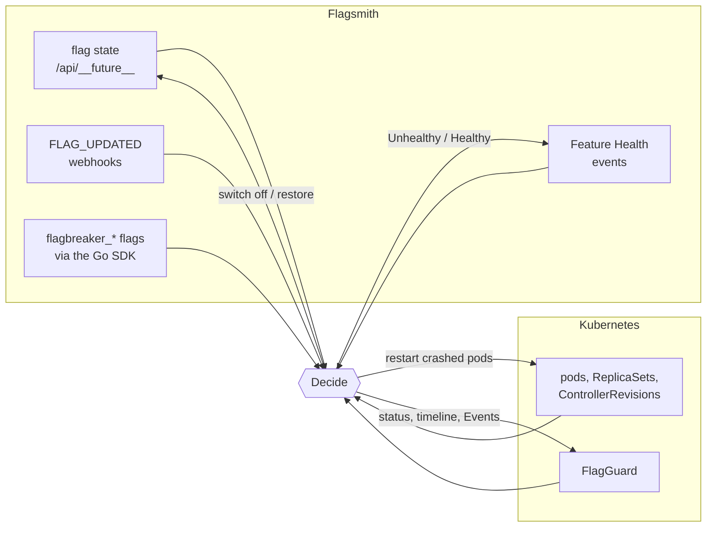
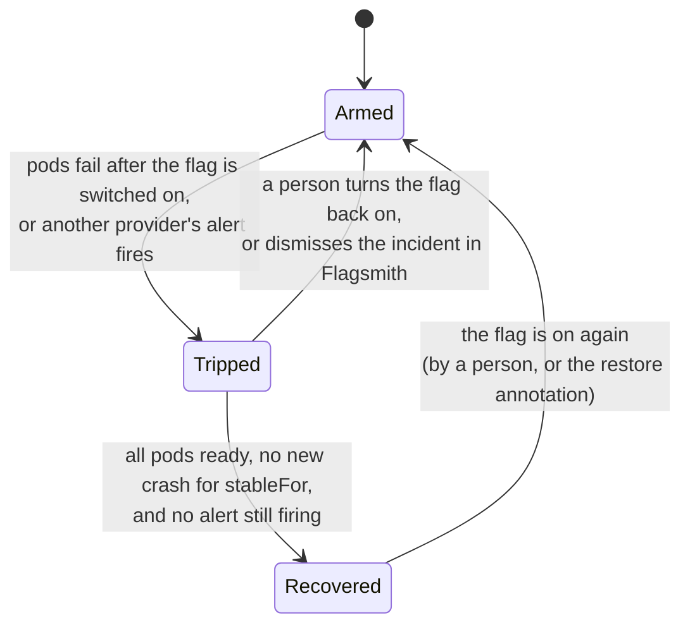

# How Flagbreaker works

Flagbreaker is a Kubernetes controller that connects Kubernetes workload
health to [Flagsmith Feature Health](https://docs.flagsmith.com/advanced-use/feature-health).
When a workload breaks right after a flag is switched on, or another Feature
Health provider marks the flag unhealthy, Flagbreaker:

1. reports Unhealthy to Feature Health, with an incident timeline;
2. in act mode, switches the flag off in that environment, for its default
   and every segment override that is on;
3. restarts the pods that crashed;
4. confirms recovery on the cluster and reports Healthy.

Flagbreaker never switches a flag back on by itself.

Open-source Flagsmith stores Feature Health events, but nothing in it acts on
them. Flagbreaker is a provider, sending Unhealthy events from Kubernetes, and
an actuator, acting on any provider's events.

## The loop

Every check, run per FlagGuard, does the following:
- It reads the flag, the workload's pods and Feature Health.
- It asks one pure function, [`breaker.Decide`](../internal/breaker/decide.go), what to do, then does it.

A check runs:
- when a pod changes;
- when a signed `FLAG_UPDATED` webhook arrives for the flag;
- when the guard or its annotations change;
- every `--sync-period` (5 s by default).

The guard's status holds all incident state, so the controller can restart at
any time.

## States

**Trips (Armed → Tripped).** The flag's environment default is on and one of
these holds:

- **Pods**: the flag was switched on within `window` (10 minutes by default),
  and at least `failingPods` pods failed after that. A container that exited
  non-zero or was OOM-killed counts as failing, and so does a pod not ready for
  20 s.
- **Alert**: another Feature Health provider has an active Unhealthy event
  for this flag. It counts whether the event names this environment or no
  environment.

**Never blamed**

- A change made while the workload was already failing, in the minute
  before. Kubernetes keeps a container's last crash for a long time, so
  older crashes don't count.
- A change made when a rollout started at the same time. The deploy may be
  the cause, so the trip only reports and leaves the flag on.
- A change a person acknowledged, by dismissing the incident in Flagsmith.
- An alert event already handled. A person who re-enables a flag despite an
  old alert is respected.

**Recovery is verified.** For `stableFor` after the switch-off, every pod must
be ready with no new crash, and no other provider's alert may still be firing.
A successful API call proves nothing about the workload, so Flagbreaker checks
the workload itself. With `restartCrashingPods`, the pods that crashed are
deleted once the flag is off. They then come back in seconds, not after the
kubelet's back-off, which can reach five minutes.

**Restore.** The `flagbreaker.dev/restore` annotation undoes Flagbreaker's
own switch-off. It turns on the environment default and only the segment
overrides that still exist and are still off.

- It goes through Flagsmith's update API, which creates an override that
  doesn't exist. Restoring only existing overrides keeps a person's later
  deletion deleted.
- It is refused while the guard is still tripped.
- The restore counts as a flag change. If the workload breaks again, the
  breaker trips again, which makes it a half-open probe on demand.

## Who decides the mode

Flagbreaker asks three settings, and the most cautious answer wins. It
switches a flag off only when something says `act` and nothing says `watch`.
With no answer at all, it watches.

| Setting | Where | Scope |
|---|---|---|
| `spec.mode`, or the `flagbreaker.dev/mode` annotation | Kubernetes | one guard |
| `flagbreaker_policy`, for example `{"new_pricing": {"mode": "watch"}}` | Flagsmith remote config | one flag (`off` ignores it) |
| `flagbreaker_mode` (`watch` or `act`) | Flagsmith remote config | every flag |
| `flagbreaker_enabled` | Flagsmith flag | off pauses everything |

These settings can also change the mode during an incident:

- A switch to `watch` in Flagsmith stops an incident that is acting.
- A switch to `act` never takes effect mid-incident.
- If Flagsmith can't be read, or the policy is invalid JSON, Flagbreaker
  watches.

## Flagsmith APIs used

All of these are in open-source, self-hosted Flagsmith. Flagbreaker is tested
against 2.295.2.

| Endpoint | For | Auth |
|---|---|---|
| `GET /api/v1/environments/{key}/` | environment name, ID and project | org API key |
| `GET /api/v1/projects/{id}/features/?search=` | feature ID, matched by exact name | org API key |
| `GET`/`PATCH /api/__future__/environments/{key}/features/{id}/` | read the flag; switch off the default and segment overrides in one versioned change; restore | org API key |
| `GET /api/v1/projects/{id}/feature-health/events/` | other providers' alerts, and dismissals of Flagbreaker's own events | org API key |
| `POST /api/v1/feature-health/{signed-path}` (Webhook provider) | report Unhealthy and Healthy, with text and URL blocks | the signed path |
| environment webhook `FLAG_UPDATED` (HMAC-SHA256 `X-Flagsmith-Signature`) | exact change time and author | shared secret |
| Flagsmith Go SDK, `GetEnvironmentFlags` | the breaker's own settings | environment key |

The `__future__` endpoint works with and without feature versioning. The older
feature-state endpoints return 400 under versioning v2.

## Safety

- **Leader election.** Only one replica ever changes flags.
- **Change requests.** If an environment requires change requests, Flagsmith
  answers 409. Flagbreaker then drops to watch and sets the
  `BlockedByChangeRequests` condition; it never gets around four-eyes approval.
- **What it never touches.** It doesn't change identity overrides or
  experiments' system segments. The timeline says so instead of claiming a
  clean switch-off.
- **One health slot.** Feature Health keeps one Webhook-provider status per
  flag and environment. Healthy is reported only when every guard of that flag
  has recovered.
- **Fresh reads.** Each check reads the guard past the controller's cache.
  A check never starts from a status older than the last one written, so an
  action is not repeated from stale state.
- **Credentials.** The org API key and the Feature Health path live in a
  Secret, never in flags or the pod spec. Health event URLs are redacted in
  logs.

## Watching a workload

You can watch a workload in two ways:
- The one-line way: annotate a Deployment, StatefulSet or DaemonSet with
  `flagbreaker.dev/flags: "flag_a,flag_b"`. Flagbreaker creates one FlagGuard
  per flag, owned by the workload, and deletes them with it.
- The full way: write a FlagGuard yourself.

The annotation can also set these options:

| Annotation | Sets |
|---|---|
| `flagbreaker.dev/environment-key` | `spec.environmentKey` (defaults to `--default-environment-key`) |
| `flagbreaker.dev/mode` | `spec.mode` |
| `flagbreaker.dev/stable-for` | `spec.stableFor` |
| `flagbreaker.dev/runbook-url` | a Runbook link in every Feature Health event |

## Metrics

These are served on `:8080/metrics`, next to controller-runtime's own metrics.

| Metric | What it counts or measures |
|---|---|
| `flagbreaker_trips_total` | trips, by guard, flag, environment, mode and cause (`pods` or `alert`) |
| `flagbreaker_switch_offs_total` | switch-offs, by who did it (`flagbreaker` or `person`) |
| `flagbreaker_recoveries_total` | verified recoveries |
| `flagbreaker_restores_total` | restores |
| `flagbreaker_check_errors_total` | checks that failed |
| `flagbreaker_detection_seconds` | from the change to the trip |
| `flagbreaker_switch_off_seconds` | from the trip to the switch-off |
| `flagbreaker_recovery_seconds` | from the switch-off to verified recovery |
| `flagbreaker_guard_phase` | each guard's current phase |

## Tests

- `go test ./...` runs these suites:
  - [`breaker`](../internal/breaker/decide_test.go): the decision rules.
  - [`workload`](../internal/workload/assess_test.go): pod assessment.
  - [`settings`](../internal/settings/settings_test.go): mode resolution.
  - [`flagsmith`](../internal/flagsmith/client_test.go): the API client.
  - [`changes`](../internal/changes/webhook_test.go): webhook verification.
  - [`controller`](../internal/controller/controller_test.go): whole incidents,
    run through `Reconcile` against a fake Kubernetes API and a fake Flagsmith
    that speaks the same HTTP API.
- `bash hack/demo/e2e-all.sh` runs the same stories against the real thing:
  kind, the official Flagsmith Helm chart and the demo app. CI runs it on
  every push.

## Limitations

- **Only the environment default is tracked as a flag change.** A rollout
  through a segment override alone doesn't start the pods rule. If those users
  see errors, follow them with an alert (the alert rule).
- **Who changed a flag can be lost.** Flagsmith fills `FLAG_UPDATED` with the
  flag's state when the webhook is sent, a few seconds after the change, not
  at the change. When Flagbreaker switches the flag off within those seconds,
  the webhook for the person's change can already show Flagbreaker's state.
  The timeline then says "switched on" without a name.
- **Feature Health is a beta, and the `__future__` endpoint is marked
  experimental.** The demo pins Flagsmith 2.295.2. Under 2.295.2 a reason must
  include both `text_blocks` and `url_blocks`, so both are always sent.
- **The Webhook provider's slot is shared.** Use it for Flagbreaker only, and
  report other systems' health through their own providers, such as Grafana.
- **Self-hosted Flagsmith without a licence allows one project and one seat
  per organisation.** So the demo uses the org API key rather than a
  least-privilege user.
